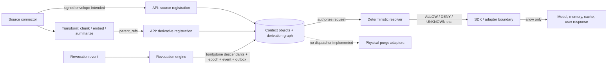

# ALES INVARIANT: Engineering Assessment

Assessment date: 11 November 2026. Repository state inspected: working tree clean at the time of inspection; benchmark report records revision ce95de2. This review describes the checked-in implementation, not planned capability. Line references point to the current workspace files.

## 1. Executive engineering assessment

ALES INVARIANT is a small, structured Python project implementing one meaningful infrastructure primitive: track source-to-derivative lineage, calculate conservative authority inheritance, and deny future instrumented reads when a registered ancestor is revoked. The core is more than a mock: it has a versioned JSON contract, SQLAlchemy persistence, deterministic decision code, a FastAPI API, a Python client, wrappers and a scenario harness. The core unit suite passes locally.

It is not currently a secure enterprise runtime. The HTTP API has no implemented authentication or authorization; tenant identity comes from caller-supplied body/header fields. The server accepts unsigned objects despite the signing feature in the spec, its signer does not implement the stated RFC 8785 canonicalization, and it does not consume signature keys. Offline mode is an allow cache with a lease, not a verified signed policy snapshot. The adapters are explicitly all pending conformance in the coverage matrix. The invalidation outbox has no dispatcher. There is no real cloud integration, distributed policy plane, or deployed agent lifecycle.

The project has a credible, focused *problem hypothesis* and a useful prototype foundation for a data-lineage revocation SDK/runtime. It is not yet a credible basis for companies to deploy protected workloads. The near-term product should be a reliable, authenticated source authority and revocation service plus a genuinely conformant set of enforcement adapters. Do not broaden into a general agent control plane until those guarantees are made real and independently tested.

**Central answer:** The code is a promising Level 2 structured application with some Level 3 design intent, not infrastructure-grade software. It can become a specialized enterprise context governance service, but enterprise deployment requires substantial security and operational redesign before feature expansion. It should complement broad agent action-governance tools, rather than attempt to clone every feature category.

### Findings that most affect the verdict

| Priority | Finding | Evidence |
|---|---|---|
| Critical | No API auth, issuer identity, role checks, or authenticated tenant binding. `auth_token` is only attached by the SDK; routes never validate it. | [routes.py](/C:/Users/mahes/OneDrive/Desktop/Ales/AlesProj1/server/ales_server/routes.py:35), [client.py](/C:/Users/mahes/OneDrive/Desktop/Ales/AlesProj1/sdk-python/ales_sdk/client.py:121) |
| Critical | Signatures are optional and never verified on source, derivative or revocation ingress. The implemented canonical JSON is ordinary Python JSON, not RFC 8785 JCS. | [signing.py](/C:/Users/mahes/OneDrive/Desktop/Ales/AlesProj1/core/ales_core/signing.py:20), [SPEC.md](/C:/Users/mahes/OneDrive/Desktop/Ales/AlesProj1/spec/SPEC.md:69), [routes.py](/C:/Users/mahes/OneDrive/Desktop/Ales/AlesProj1/server/ales_server/routes.py:57) |
| Critical | All adapter coverage statuses are pending, per the project’s own matrix. | [coverage-matrix.md](/C:/Users/mahes/OneDrive/Desktop/Ales/AlesProj1/docs/coverage-matrix.md:14) |
| High | Revocation creates outbox rows but nothing in this repo dispatches them or performs purge/retry. | [revocation.py](/C:/Users/mahes/OneDrive/Desktop/Ales/AlesProj1/core/ales_core/revocation.py:32), [db.py](/C:/Users/mahes/OneDrive/Desktop/Ales/AlesProj1/core/ales_core/db.py:117) |
| High | Docker wires Redis, but the application does not read REDIS_URL; Redis-backed adapter exists only as an optional generic wrapper. | [docker-compose.yml](/C:/Users/mahes/OneDrive/Desktop/Ales/AlesProj1/deploy/docker-compose.yml:29), [redis_cache.py](/C:/Users/mahes/OneDrive/Desktop/Ales/AlesProj1/adapters/ales_adapters/redis_cache.py:37) |
| High | Local verification is incomplete here: 58 core tests and 31 SDK tests pass; server tests stall at the first TestClient request in this Python 3.13/Starlette environment. Adapter and benchmark suites were not established as passing. | Test results in §14 |

## 2. The problem and where ALES fits

Enterprise AI systems can retain and reuse data long after its source access changes. An approved document may be chunked, embedded, summarized into agent memory, placed in a response cache, or handed to another agent. The source system may later delete it, supersede it, classify it differently, or remove a user’s access. The RAG store or agent memory typically has no complete record of which source versions influenced which derived records, so ordinary source ACL checks do not invalidate downstream copies.

ALES is trying to provide a **context authority and lineage plane** beside an existing AI stack. Its intended boundary is: register the source and each transformation, preserve all candidate parents, compute restrictive authority, then authorize a derivative at each read/handoff immediately before it enters a model or user response. It does not host models, orchestrate agents, supply business tools, or replace vector databases. In a stack diagram, it sits between source connectors and retrieval/memory/cache/prompt assembly boundaries, with a control API and metadata graph behind SDK/adapter checks.

Existing agent frameworks focus on orchestration and tool use; cloud providers provide model hosting, identity, logging and network controls, but those controls do not automatically create provenance edges across application-specific transformations in a customer’s agent memory and cache. This is a reasonable gap. ALES’s potential differentiator is *authority propagation through derived context and use-time revocation*, not generic “AI governance.” A policy engine can decide whether a tool call should run; ALES can decide whether a particular piece of derived context is still authorized. They can coexist.

Essential capabilities are trustworthy source registration, complete derivation lineage, authorization semantics that match real identity/ACLs, and enforcement at every protected read/handoff. Audit records, key management, multi-tenant isolation and reliable delivery then make those capabilities operable. Premature today: a broad multi-cloud control plane, custom agent orchestration, many connectors, distributed microservices, and compliance badges. A company would deploy this only if it can prove complete enough coverage for a high-value data flow, integrate its identity and source ACL system, and show that revocation prevents retrieval through its actual production paths.

## 3. Complete architecture walkthrough

### Major modules

| Area | Actual responsibility and limits |
|---|---|
| spec/ | JSON Schema contracts and normative v0.1 behavior. Strongly states semantics, including signed RFC 8785 events and fail-closed protected data. Runtime does not yet satisfy all of these. |
| core/ales_core | Pydantic envelopes/events; SQLAlchemy tables; tenant-partitioned graph queries; conservative authority propagation; deterministic resolver; revocation tombstoning and outbox enqueue; Ed25519 signing helpers. This is the most mature part. |
| server/ales_server | FastAPI routes for source/derivative registration, revocation, authorization, lineage, health and a verification scenario. Creates schema with create_all on app startup. No auth middleware or production policy distribution. |
| sdk-python/ales_sdk | Synchronous HTTP client, allow-only in-process decision cache, helper wrappers, local session context tracking, fail-mode mapping, envelope builders and CLI. It is Python-only. |
| adapters/ales_adapters | Filesystem source scanner; generic Redis-like guarded cache; vector wrapper; framework-neutral LangGraph node wrappers. PgVectorBackend is currently a plain SQL table with JSON vectors and Python cosine over every row, not PostgreSQL pgvector. |
| conformance/ | Small contract runner for in-repo vector/cache/LangGraph subjects and filesystem ingestion. It is included in configured pytest paths, but the documented coverage matrix still labels adapters pending. |
| benchmark/ | Eight deterministic scenario families and report generator. Current checked-in report is in-process, SQLite, small graph and sequential. Its caveats are usefully stated. |
| examples/ | Revocation demonstration: hashes terms into a toy embedding, chunks text, truncates to simulate summary, and exercises cache/memory/vector authorization. It does not invoke an LLM. |
| deploy/ | One Docker Compose stack with Postgres, Redis and API. API uses Postgres; Redis URL is not consumed by server. Compose has demo credentials and no auth/TLS/secret provisioning. |
| docs/ | Threat model, integration guide, guarantees, coverage matrix, contributing/security policies. Good conceptual scoping; several claimed runtime capabilities remain aspirational. |

## 4. Data flow and execution flow

### Flow



On ingestion, the SDK builds an envelope with a SHA-256 digest and parent references. `GraphStore.register_derivation` verifies parents exist and rejects an authority claim wider than computed inheritance. Authorization loads the requested node and recursive ancestors, evaluates tombstones, expiry, principal/purpose scope and quarantined trust, then returns the most severe decision. Revocation walks descendants in the same tenant, tombstones known nodes, increments an epoch, stores the event and enqueues invalidation records in a transaction. SDK adapters query authorization before returning retrieval/cache content.

Important flow gaps: caller identity and tenant are not authenticated; agent_id/session_id are accepted but do not affect the core decision. `affected_scope` is persisted but not used for deciding which principals/purposes are affected. `effective_at` is persisted but revocation applies immediately regardless of its timestamp. Signatures are not checked at the ingress. Physical invalidation is not delivered. Decision audit output is a structured application log, not a tamper-evident, durable audit ledger. SDK session taint records IDs but does not enforce a session reset or re-check all previous context by itself.

## 5. Directory and module analysis

The root contains one Python package definition in [pyproject.toml](/C:/Users/mahes/OneDrive/Desktop/Ales/AlesProj1/pyproject.toml), plus the directories summarized above. Dependencies are Pydantic, SQLAlchemy/Alembic, FastAPI/Uvicorn, HTTPX, cryptography, jsonschema and Redis; dev extras include pytest/Hypothesis/mypy/ruff/Postgres driver; LangGraph/pgvector are demo extras. Alembic is a dependency but there are no migration files or migration runner. jsonschema is declared but the core validation path shown uses Pydantic models; inspect actual consumers before retaining dependencies.

The main coupling is Python import-level coupling across separate source directories rather than separately versioned distributions: adapters import SDK and SDK server paths use the core. This is workable for a small monorepo but means the public contract and package boundaries are not yet independently releasable. The DB model stores graph edges as a separate table and JSON arrays for scopes. There is no event broker, outbox worker, migration strategy, external identity provider, key registry, or cloud-provider abstraction. Database schema is created directly from ORM metadata.

There is no large redundant subsystem; most modules have one clear responsibility. There is a mismatch between the named PgVectorBackend and its actual brute-force JSON implementation, and between the “runtime”/“control plane” ambition and the actual single API plus SDK wrappers. Avoid expanding the existing outbox/SDK abstractions before write consistency, durable effects and identity are specified.

## 6. Engineering maturity ratings

Scale follows the requested 1–5 rubric. Scores evaluate implementation today, not intended architecture.

| Dimension | Level | Reason |
|---|---:|---|
| Architecture | 2 | Clean core/server/SDK/adapters separation and a written spec, but one-process control plane, no production persistence lifecycle or extensible contract rollout. |
| Code quality | 2 | Mostly understandable, typed Python and focused modules; meaningful edge cases/tests. Runtime/spec mismatch and overclaiming names/compose wiring reduce confidence. |
| Backend engineering | 2 | CRUD-like API, ORM graph and deterministic resolver work; no auth, migration discipline, queue worker, rate limiting, readiness, or operational lifecycle. |
| Governance implementation | 2 | Real lineage, scope inheritance, tombstone and deny decisions. Generic tool/action policy, agent registration/lifecycle, approvals, policy authoring/distribution are absent. |
| Security | 1 | Important cryptographic primitives and fail-closed ideas exist, but the enforcement service trusts unauthenticated caller-supplied tenant and unsigned envelopes/events. Not safe to deploy. |
| Agent infrastructure | 1 | Agent identifiers and session fields are metadata; no agent lifecycle, execution sandbox, tool authorization or isolation. One LangGraph-style hook is not an agent runtime. |
| Integration architecture | 2 | Generic wrapper patterns and connector shape exist. Only four in-repo adapters, no cloud identity/model integrations, and no conformant status declared. |
| Testing | 2 | 58 passing core tests, 31 SDK tests and scenario/conformance code. Runtime integration blocked in this environment; missing test paths from default CI selection and no real DB/network/concurrency/chaos evidence. |
| Documentation | 3 | Strong spec, threat/guarantees docs, caveats and contributor/security instructions. Practical setup and implemented-vs-planned status need to be more explicit. |
| Production readiness | 1 | No auth/signature enforcement, unprocessed outbox, demo secrets, no migrations, no proven deployment or operational SLOs. |

## 7. Comparison with Microsoft Agent Governance Toolkit

The reference is [Microsoft’s Agent Governance Toolkit repository](https://github.com/microsoft/agent-governance-toolkit), viewed on 11 November 2026. The comparison below distinguishes the project’s published scope and repository surface from independently proven behavior. AGT’s README describes policy enforcement, zero-trust identity, execution controls, audit, reliability packages, multiple language SDKs and framework integrations. Its repository navigation shows separate Python, TypeScript, .NET, Rust and Go trees, policy engine, schemas, tests, docs, examples, CI/security automation, and a substantially larger maintained history. Its feature matrix is self-published; that is evidence of declared scope, not proof of every claim in every deployment.

| Area | ALES today | AGT repository direction/surface | Assessment |
|---|---|---|---|
| Architecture/modularity | Python monorepo with spec, core, API, SDK, adapters. | Multiple language SDKs and packages, policy engine, adapters, CLI, runtime/SRE components. | ALES has a coherent narrow kernel; AGT has far broader interface and ecosystem surface. |
| Governance/policy | Source-derived authority and revocation decisions. | Rule-driven agent/action/tool policy, approvals, identity/trust and audit, per README/docs. | Different layers. ALES may add data provenance that complements AGT; it does not match its feature set. |
| Agent lifecycle/execution | No agent registry/lifecycle or sandbox. | AGT advertises lifecycle, execution rings, termination controls and framework integrations. | Not comparable in implementation breadth. |
| Identity/security | Caller-supplied tenant and optional bearer header with no validation; unused signature verification. | AGT advertises zero-trust identity/capabilities and security controls; its README itself states governance is middleware-layer and recommends container isolation. | Both are middleware-level rather than OS isolation, but ALES currently lacks the basic trust boundary. |
| Audit/observability | JSON decision logs and optional OTel span API; no durable immutable audit store. | AGT advertises audit trail, CLI/dashboard and SRE package. | ALES has instrumentation starter pieces, not enterprise audit operations. |
| Integrations | Filesystem, generic cache/vector wrappers and LangGraph-style decorator. | Broad framework list, five language package families, MCP/A2A and cloud deployment docs per repo. | ALES should focus on verified revocation connectors rather than imitate breadth. |
| Tests/docs | Real core tests and one benchmark harness; no production conformance claim; source docs are candid. | Repository advertises formal specs, broad tests, security automation and extensive docs. | AGT is a much stronger benchmark for maturity and ecosystem. ALES has a good spec-first instinct, but should first make spec/test/runtime agree. |

**Ambition vs feature vs maturity:** ALES can match the *ambition* of making governance infrastructure portable. It does not match AGT’s declared feature set, breadth of SDKs/integrations, or engineering ecosystem. It should not attempt full parity; its strongest position is a precise complementary capability AGT-like systems may not provide: source authority propagation across derived context and revocation at data-use boundaries. AGT public project sources: [repository README and tree](https://github.com/microsoft/agent-governance-toolkit), [architecture documentation](https://github.com/microsoft/agent-governance-toolkit/blob/main/docs/ARCHITECTURE.md), [package feature matrix](https://github.com/microsoft/agent-governance-toolkit/blob/main/docs/PACKAGE-FEATURE-MATRIX.md), [governance model](https://github.com/microsoft/agent-governance-toolkit/blob/main/docs/GOVERNANCE.md).

## 8. Security and governance assessment

### Implemented

- Deterministic scope/classification/trust/expiry inheritance in [propagation.py](/C:/Users/mahes/OneDrive/Desktop/Ales/AlesProj1/core/ales_core/propagation.py).
- Parent existence and cross-tenant graph partitioning during derivation registration in [graph.py](/C:/Users/mahes/OneDrive/Desktop/Ales/AlesProj1/core/ales_core/graph.py).
- Recursive ancestor checks and tombstone-based denial in [resolver.py](/C:/Users/mahes/OneDrive/Desktop/Ales/AlesProj1/core/ales_core/resolver.py).
- Ed25519 sign/verify helper functions, but not required or wired into ingress.
- Client-side fail modes and an in-process ALLOW-only cache; default mode is ENFORCE.
- Threat model and guarantee docs are explicit that uninstrumented paths and prior exposure are out of scope.

### Missing or inconsistent with spec

1. **Authentication and authorization:** The API does not authenticate the bearer token and has no principal/role check. `_check_tenant` only rejects a body/header mismatch. Any network-reachable caller can submit a tenant ID, create graph objects, authorize against it, or submit a revocation. This makes tenant separation a data-filter convention, not a security boundary.
2. **Signature trust:** `signature` is optional in Pydantic; route handlers pass models directly to GraphStore/RevocationEngine. No key IDs, trusted issuer registry, key rotation or verification step exists. `canonical_bytes` uses `json.dumps(sort_keys=True, ...)`, which does not implement RFC 8785 canonical JSON as promised by SPEC.
3. **Revocation scope/time:** Revocation applies to all descendants of the selected source version immediately. `affected_scope` and `effective_at` are stored but not used to scope or time enforcement. This can over-revoke and cannot accurately represent scheduled or principal-scoped changes.
4. **Audit:** Decision logs are useful diagnostics but are only logger output. Revocation rows are mutable database records with no tamper-evident chaining or retention controls. Actor fields are caller-provided, hence not an identity proof.
5. **Offline:** BOUNDED_OFFLINE reuses cached ALLOW decisions and checks elapsed monotonic time since last successful HTTP response. It does not validate a signed policy snapshot. This is materially weaker than the documented snapshot mechanism. Cache key includes object, version, principal ID, purpose and policy version, but not tenant or principal type; this is risky if a cache is shared across client contexts.
6. **Identity enforcement:** `principal.type`, `agent_id`, `session_id`, policy_version from envelopes and session taint do not establish authentication or agent capabilities. Session taint is a local record/check utility, not automatic revocation reaction.
7. **Operational controls:** No rate limits, request size policy beyond framework defaults, admin boundary, DB row security, key vault, TLS configuration, readiness/dependency check, backup/restore, worker health or incident procedures in deployment.

Security conclusion: keep this on localhost or in a controlled test network with synthetic data until authenticated tenant mapping, required signature verification, auditable revocation semantics and production storage isolation are implemented and tested.

## 9. Scalability assessment

The graph model and contract can be scaled conceptually, but the current runtime is a synchronous single API with SQLAlchemy sessions, recursive CTE traversals and no measured deep/wide graphs. Every authorization can traverse ancestors and load rows; revocation enumerates descendants and inserts one outbox row per affected object in one transaction. That is reasonable for a small prototype and can become expensive on high-fanout lineage. Indexes cover tenant/context and edge parent/child, but no scale profile is included.

| Direction | Current fit | What must change |
|---|---|---|
| Standalone governance SDK | Most feasible. Existing Python client/helpers provide a base. | Stable public protocol, sync/async clients, actual conformant adapters, typed/versioned APIs, authenticated issuer and cache semantics. |
| Governance runtime | Plausible narrow service. | AuthN/Z, migrations, signature trust, policy semantics, durable audit, queue/outbox worker, health/readiness, SLOs, scale tests and runbooks. |
| Multi-agent control plane | Not supported beyond metadata fields. | Agent identity and lifecycle, delegated capabilities, tool permission policy, session/kill controls, execution boundary integrations. This is a different substantial product. |
| Enterprise management platform | Not supported. | Fleet inventory/admin, policy distribution, tenant admin plane, connectors, dashboards, support/upgrade controls and compliance evidence. Do not start here. |
| Cross-cloud/on-prem layer | Portable Python DB/API is a useful start, but no Azure/AWS integrations exist. | Provider-neutral credential and identity contracts, pluggable KMS, monitoring, networking/deployment adapters, private endpoints, tested Postgres, tenancy model and provider conformance suites. |

Multi-tenancy today is a tenant_id filter in graph queries and tenant epoch rows; identity is not bound to that tenant, and storage-level row security is absent. There are no worker replicas or distributed coordination. Redis does not serve shared decision cache or pub/sub invalidation. Horizontal stateless API replicas could be possible after idempotency/concurrency tests, PostgreSQL migration, auth, and distributed cache epoch propagation. Microservices are not yet justified: first make the single service correct, then separate outbox processing only when queue load or independent scaling requires it.

Storage needs are metadata-first. The platform need not own document content or vector search, which helps portability. It must, however, avoid global full scans in the sample vector backend and clarify whether the graph stores complete parent refs as queryable edges or only immutable facts in table rows. API/schema versioning currently exposes v1 and policy p0 but has no migration tooling or backward-compatibility tests.

## 10. Azure and AWS integration assessment

Current source inventory shows no Azure/AWS SDKs, identity providers, model clients or deployment templates. `DATABASE_URL` is the only meaningful server environment configuration; `REDIS_URL` in Compose is unused by the API. Thus all cloud capability below is **missing**, not implemented.

| Requirement | Azure | AWS | Provider-neutral design needed |
|---|---|---|---|
| Model endpoints | No Azure OpenAI or AI Foundry client/adapter. | No Bedrock client/adapter. | Keep model calls outside core; define optional telemetry/identity hooks, avoid provider-specific policy in resolver. |
| Identity | No Entra OIDC/JWT verification, managed identity, groups/claims mapping. | No IAM/STS/SigV4 or workload identity mapping. | Map verified external subject and tenant to canonical principal and issuer; define group/purpose claims contract. |
| Keys/secrets | No Key Vault integration. | No Secrets Manager/KMS integration. | Key-provider interface with sign/verify, key IDs, rotation/revocation, envelope issuer trust. Never accept a free-form key reference as proof. |
| Monitoring | OTel API span helper only; no Azure Monitor exporter or dashboards. | No CloudWatch integration. | OTel spans/metrics and structured security events, with privacy controls and durable audit export. |
| Network/private deployment | Compose only; no private endpoint or Azure networking instructions. | Compose only; no VPC deployment or AWS networking. | Container deployment, private ingress/egress, TLS, trust roots, health checks, backup and upgrade docs. |
| Enterprise access | Caller-supplied tenant IDs are not acceptable. | Same. | Enforce tenant binding from verified identity at middleware, service and DB layers. |

Build one provider-neutral SPI around verified identity, signing/key lookup and telemetry first. Implement Azure/AWS adapters behind it only when there is a specific customer deployment path; do not sprinkle provider SDKs through core decision logic.

## 11. What the project can realistically become

The realistic and defensible product is a context provenance and revocation service for AI/RAG applications: a lightweight control API plus SDK and enforcement adapters that preserve source authority as data becomes chunks, summaries, caches and agent memory. It can be valuable independently or as a subsystem within a broader agent governance stack.

It should not claim to be a general enterprise agent governance toolkit until it enforces tool permissions, agent identity/lifecycle, execution isolation, incident controls and broad observability. Those features are not required for its differentiated use case. The “infrastructure-grade” bar for the narrow product is instead: source ACL connectors, complete supported path coverage, authenticated decisions, key trust, crash-safe revocation, measurable exposure bounds, multi-tenant safety, stable APIs and tested deployment/operations.

## 12. Critical architectural and implementation gaps

The critical gaps are the missing authentication and tenant binding, signature verification, revocation scope/time semantics, durable audit, correct offline snapshot protocol, adapter conformance, outbox processing, DB migrations and real deployment evidence described in §§8–10. These issues should be resolved before the service handles enterprise data.

## 13. Prioritized engineering roadmap

### P0 — close security boundary before deployment

1. Add authenticated API principals and roles; bind tenant ID from a verified identity claim. Require authorization for ingest, revoke, inspect and admin paths. Add negative cross-tenant API tests.
2. Require envelope/event signatures for trusted producers. Implement actual RFC 8785 canonicalization, issuer/key ID, trust registry, rotation and explicit invalid/missing signature rejection. Do not treat helper round-trip tests as ingress security.
3. Define revocation semantics for `effective_at` and `affected_scope`; test delayed, scoped, duplicate, reordered and unknown-source events. Reconcile code/spec before advertising guarantees.
4. Replace demo compose credentials with explicit local-only defaults and secrets injection; configure TLS/private ingress for deploy profiles. Add database isolation strategy and least-privileged roles.

### P1 — make decisions reliable and reviewable

5. Implement a signed bounded-offline snapshot protocol and cross-process epoch invalidation, or remove BOUNDED_OFFLINE claims until it exists. Include tenant and principal type in cache keys.
6. Build durable append-only audit records with authenticated actor identity, correlation IDs, export/retention, and tamper evidence. Keep document content out of logs.
7. Add migrations (Alembic is already declared), schema compatibility/version upgrade tests, API contract tests and readiness checks.
8. Define transaction behavior for adapter writes. Today metadata registration and external vector/cache write are separate operations; a backend failure can leave orphaned metadata or vice versa. Add retry/idempotency/reconciliation.

### P2 — prove path coverage and operational reliability

9. Run and publish conformance results for each adapter; change the matrix from pending only after path-specific tests pass. Label filesystem source connector as ingestion-only.
10. Implement the outbox consumer, leases/locking, idempotent purge, retry/dead-letter monitoring and replay. Test crashes between tombstone and external deletion.
11. Add tests for API auth, signature ingress, invalid and delayed revocations, tampering, tenant spoofing, cache leakage, concurrent revoke/read races, database constraints, real Postgres and multiple processes.
12. Measure deep/wide graph cost, large tenant throughput, error budgets and resource use. Preserve the existing honest benchmark caveats; add network/Postgres/replica test profiles.

### P3 — integrations and ecosystem, after foundations

13. Pick one identity provider and one source system based on a real pilot; implement and document them end to end. Then validate a cloud-independent connector contract.
14. Add async SDK/client and additional framework/store adapters only where each adapter can identify all ingress, derivation and retrieval points and can block.
15. Define stable release/versioning policy, API deprecation windows, Python package layout, integration support matrix and an operational manual.

### Do not build yet

- Multi-cloud management dashboard, marketplace, agent orchestration, speculative microservices, generic “AI compliance” scoring, large connector catalogs, or a second policy language.
- Performance-driven distributed graph architecture before production-like measurements.
- Claims of instantaneous revocation, complete agent governance, compliance certification, or universal framework coverage.

## 14. Practical hands-on testing manual

Commands below are for PowerShell from the repository root. The checked-in `.venv` was Python 3.13.5; project metadata supports Python 3.11+, while CI uses 3.12 on Ubuntu. For best parity, use Python 3.12. Docker is needed only for Postgres/Redis stack tests. No cloud credentials or model API keys are needed for local core/demo tests.

### A. Initial setup and start

```powershell
py -3.12 -m venv .venv
.\.venv\Scripts\Activate.ps1
python -m pip install --upgrade pip
python -m pip install -e ".[dev,demo]"
```

Set `DATABASE_URL` only if using another database. Default is local SQLite at `./invariant.db`; tests use isolated in-memory SQLite. The example demo is in-process and does not need Docker, Redis, an API key or an LLM. Run:

```powershell
python examples\revoke-rag-source\demo.py
```

Expected: 11 checkpoints pass, including retrieval/cache/memory allowed before an ACL change and denied afterward. This demonstrates an instrumented toy flow, not real model behavior or production deployment.

Optional container stack:

```powershell
docker compose -f deploy\docker-compose.yml up --build -d
Invoke-RestMethod http://localhost:8787/v1/healthz
python examples\revoke-rag-source\demo.py --server http://localhost:8787
docker compose -f deploy\docker-compose.yml down
```

Expected health result is `{ status = "ok" }`; demo should pass. Current compose starts Postgres and Redis with development credentials and no production security controls. API currently uses Postgres; no server code consumes Redis URL. If startup fails, inspect `docker compose ... logs invariant-server postgres redis`, database readiness, port conflicts and installed psycopg.

### B. Unit testing

```powershell
python -m pytest -q core/tests
python -m pytest -q --basetemp=.pytest-tmp-sdk sdk-python/tests
```

Expected in this checkout: 58 core tests passed and 31 SDK tests passed. Core covers graph traversal/isolation, authority inheritance, resolver and revocation transaction semantics. SDK covers client, cache, wrappers, fail modes, CLI and session bookkeeping. A warning appears because pytest-asyncio is not installed in the current environment although `asyncio_mode` is configured; install dev extras in a clean environment.

For API tests, try:

```powershell
python -m pytest -vv --basetemp=.pytest-tmp-server server/tests
```

Expected: 11 API tests. In this assessment environment the run stalled at `server/tests/test_api.py::test_healthz`, the first Starlette TestClient request, even with a workspace basetemp. This suggests an environment/dependency interaction; investigate compatible FastAPI/Starlette/HTTPX versions and run in Python 3.12/Linux CI before treating the API suite as passed. Ctrl+C stops the stuck run. The TestClient deprecation warning about HTTPX also appears.

### C. Integration and conformance

```powershell
python -m pytest -q --basetemp=.pytest-tmp-conformance conformance
python -m pytest -q --basetemp=.pytest-tmp-adapters adapters/tests
```

Expected: conformance tests report vector, cache and fake LangGraph guarded-read behavior plus filesystem ingestion; adapter tests cover Redis cache, SQL vector stub, middleware and filesystem. A pass validates these in-process subjects only. If a conformance check fails, inspect its individual `a`–`e` contract result (pre-revocation allow, post-revocation block, reason, no resurrection, unaffected control). The filesystem connector is ingestion-only and cannot prove blocking.

### D. Governance and security checks

Useful existing checks:

```powershell
python -m pytest -q core/tests/test_propagation.py core/tests/test_resolver.py core/tests/test_revocation.py
python -m pytest -q conformance
```

Expected: scope/classification/trust inheritance, deny on expired/revoked/quarantined or unknown contexts, and wrapper block behavior. These tests do **not** establish API authentication or signature verification because those mechanisms are not wired in. In a disposable local stack, verify the gap without real data: try omitting `Authorization`, then submit registration/revocation with a tenant ID. Today these routes do not reject the unauthenticated caller. Do not expose the stack externally to perform this check.

Verify invalid or missing signatures specifically: current implementation accepts unsigned envelopes/events. That is an identified deficiency, not an expected security pass. Additional required future tests include forged actor, cross-tenant ID probing, wrong principal type, malformed signature, altered signed payload, expired offline lease, cache shared between tenant/principal types, scoped revocation, concurrent reads during revoke and restart recovery.

### E. Agent workflow / end-to-end

```powershell
python examples\revoke-rag-source\demo.py
```

Scenario: filesystem source with restricted HR ACL → chunk/index into vector wrapper → deterministic text summary → cache and memory derivatives → authorize three read paths → narrow ACL → emit revocation → repeat reads. Expect no chunk/cache/memory data returned to the removed principal. The script’s “summary” is string truncation and embeddings are deterministic token hashes; it does not make an LLM call. Failure means source scanning, lineage registration, API authorization or a wrapper path is broken; use the first failed checkpoint and inspect lineages/reason codes.

The `register_output` middleware creates derivative metadata for outputs; verify consumers actually retain and check the returned context ID. A real LangGraph integration and actual agent/tool action execution are not present in the E2E scenario.

### F. Performance and reliability

```powershell
$env:PYTHONPATH = "benchmark;core;server;sdk-python;adapters"
python -m revocationbench
```

Expected: scenario report with 8 cases and exit code 0. The checked-in `benchmark/reports/latest.md` records 0 escapes in 54 post-revocation reads, 0 false blocks in 92 legitimate reads and p95 server round-trip decision time 4.95 ms for an in-process TestClient/in-memory SQLite run. It explicitly excludes real network/Postgres, multiprocess cache staleness, concurrency races, physical purge, uninstrumented paths and graph scale. Treat these as harness metrics, not production capacity. Benchmark run writes report files; preserve/copy current report first if you want to compare historical output.

No production load, multi-process, chaos, or concurrency test is currently supplied. To validate those future capabilities, run a separate disposable Postgres deployment, multiple server/SDK processes, instrument concurrent authorized reads while revoking, measure p50/p95/p99 and resource use, kill/restart the outbox worker between commit and purge, and assert no protected read escapes after acceptance. Those are manual test designs, not currently passing automated tests.

### G. Repo-wide checks and known test-selection issue

```powershell
python -m ruff check .
python -m ruff format --check .
python -m mypy core server sdk-python
python -m pytest -q
```

The repo CI runs Ruff, runs mypy with `|| true` (so type errors do not fail CI), then pytest. `pyproject.toml` testpaths only lists core, server, SDK and conformance; it omits `adapters/tests`, `benchmark/tests` and `examples/tests`, although those contain tests. Run those directories explicitly until testpaths/CI are corrected. The observed default suite stalled when entering the server TestClient test in this environment, so no full-suite pass is claimed. An SDK run without `--basetemp` also failed because sandbox temp directory creation was blocked; workspace `--basetemp` made that suite pass.

## 15. Final verdict

ALES INVARIANT is a real, legible prototype with a strong narrow invariant and better-than-average honesty about several non-guarantees. It is not merely a thin LLM wrapper: its useful core is deterministic lineage and authority revocation, which is a distinct infrastructure concern. But there is a wide gap between a sound prototype decision function and a trustworthy enterprise enforcement boundary.

The right next milestone is not feature parity with Microsoft AGT. It is a small production-shaped release where a verified identity registers signed source authority, one real enterprise connector propagates actual ACL changes, one or two adapters reliably gate real retrieval paths, revocation survives restarts and cross-process caches, and tests demonstrate the declared guarantees against Postgres and authenticated APIs. Once that milestone holds, ALES can credibly be developed as a specialized enterprise AI context governance runtime and integrate with broader action-governance platforms.

**Answer:** credible as an early foundation for a focused context lineage/revocation product; not yet credible as an enterprise AI governance platform deployment, and far from infrastructure-grade maturity. The essential work is security boundary, contract fidelity, tested adapter coverage, durable revocation delivery and operational evidence.
