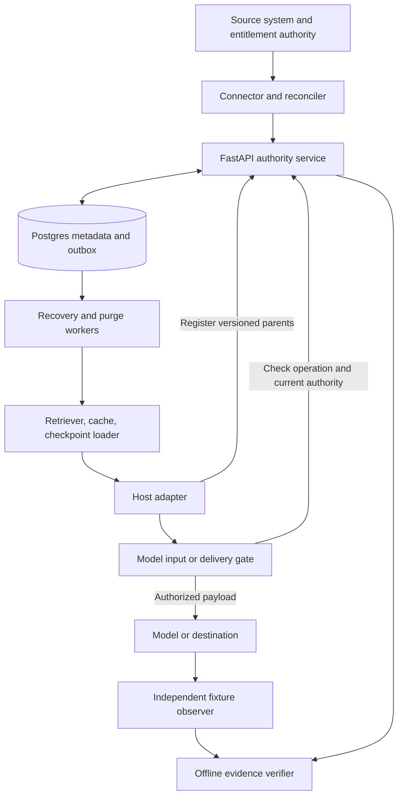

# Ales Recall technical architecture

Engineering design against repository revision `f921546` and Invariant spec v0.4. The existing runtime is the starting point. Interfaces labelled **proposed** require implementation and conformance tests.

## Enforcement boundary

A covered release consists of exact bytes supplied to a model, returned to a caller, or accepted by a destination. Bind it to a tenant, authenticated subject, acting workload, recipient, purpose, versioned input set and policy revision. Release is permitted only when the host has captured every required dependency, the source observations meet the selected freshness policy, every applicable authority check allows use, and the bytes match the authorized artifact version. Unknown lineage or an unresolved required policy holds protected bytes. An uninstrumented path has unknown coverage.

The graph records everything supplied to the computation, including prior messages, cached responses, tool results and retrieved chunks. Citations generated by a model describe a subset of that information. The authority calculation uses the captured input set. A host that cannot enumerate or isolate hidden provider-side conversation state cannot claim full coverage of resumed prompts. [Context specification](../spec/SPEC.md)



The customer data plane holds content, the checkpointer and destination credentials. The authority service handles references, decisions and event ordering. Only the gate can release protected payloads on a qualified path. Restrict direct store and model access accordingly. The offline verifier consumes evidence after execution. It has no runtime dependency on the model or cloud. Treat identifiers and graph relationships as sensitive metadata. The existing LangGraph helper embeds generated text in an object ID. Replace that with an opaque ID before exporting records. [LangGraph adapter](../adapters/ales_adapters/langgraph_middleware.py)

**Online freshness.** The Python SDK can answer an ordinary authorization request using a process-local ALLOW entry even under `ENFORCE`. The decision cache defaults to a maximum TTL of 30 seconds and knows only epochs observed by that process. Give the strict adapter an explicit online-only check for protected cache reads, checkpoint resume, model input and final delivery. Revalidate at the new boundary even if the same operation passed upstream. An authority outage holds the release. A bounded-offline profile needs a distinct identifier, signed snapshot validity and a reported lease exposure window. [Decision cache](../sdk-python/ales_sdk/decision_cache.py) · [SDK lookup](../sdk-python/ales_sdk/client.py) · [In-flight ordering test](../stress/test_inflight_revocation.py)

## Data and transaction ownership

Keep the existing graph, revocation events, tombstones, epoch, audit ledger, session state and rebuild queue in SQLAlchemy/Postgres. Use SQLite for local fixtures. Preserve the identity of each object as `(tenant_id, context_id, object_version)`. Edges reference exact parent versions. A superseded version retains its historical identity. [Storage models](../core/ales_core/db.py) · [Rebuild planner](../core/ales_core/rebuild.py)

| Proposed record | Identity and contents | Commit rule |
|---|---|---|
| Source event inbox | Unique tenant, connector instance and upstream event ID. Store canonical event digest, stable Ales event UUID, source revision, observed time and processing state. | Persist before acknowledging the feed. Repeated identical input returns its prior result. A conflicting digest for the same ID pauses that feed for reconciliation. |
| Source cursor | Tenant, connector and partition. Store last contiguous applied cursor, last authoritative reconciliation, freshness deadline and health. | Advance only after durable event acceptance for the contiguous prefix. For opaque cursors use the provider's continuation contract. Record a gap when continuity cannot be established. |
| Checkpoint binding | Tenant, host instance, thread, checkpoint namespace and checkpoint ID. Store session generation, manifest of parent references, digest of restored state and capture-format version. | On the host, publish the checkpoint and its binding atomically where possible. Across separate stores, stage privately, confirm graph registration, then expose a committed pointer. Resume requires a committed binding. |
| Release operation | Unique tenant and request key. Store authenticated descriptor, descriptor digest, versioned object refs, decision reference, generation, status and expiry. | A duplicate request key with a different descriptor returns a conflict. Each newly attempted dispatch needs a current authority check, including a retry of an older permitted operation. |
| Receiver observation | Receiver identity, run ID, operation ID, payload commitment, recipient, result and receive time. | The receiver writes its idempotency record and local effect in the same transaction if it supports transactional acceptance. Its independently recorded result is evidence for that destination. |

Scope semantics differ between two existing types. An empty envelope principal allow-list means nobody may read the object. An empty principal axis in a revocation scope matches all principals. Compute membership deltas explicitly. An empty removal delta produces no event. Where upstream identities include several issuers, map them to stable tenant-unique internal subject IDs before emitting simple principal strings. A membership change with unknown scope puts the affected source under a freshness hold until reconciled. [Scope contract](../spec/SPEC.md) · [Tombstone matcher](../core/ales_core/tombstones.py)

The generic source connector currently treats a narrowed ACL as retirement of the old context and registers a new one. Selective enforcement in the core alone cannot keep the same derivative available to unaffected principals when its connector emits a global revocation. Qualify scoped changes only on a connector that can map authoritative removals to the correct subjects and purposes. Record an unsupported capability when the source supplies insufficient detail. [Connector update path](../connectors/ales_connectors/spi.py) · [Scoped and delayed revocation tests](../core/tests/test_scoped_delayed.py)

## Write and read protocols

**1. Accept an authority change.** The connector verifies its authenticated source and maps the event to an existing signed `RevocationEvent`. It assigns the same Ales UUID to every retry of the same upstream event. The current revocation engine commits internally and deduplicates by Ales event ID. A worker may therefore crash after the revocation commit but before advancing its connector cursor. Replay the same signed event and UUID, verify the stored tenant and body binding, then finish the cursor update. Add that binding check at ingress before relying on deduplication. An event replay with conflicting content is an integrity failure. Process source ordering per partition and retry gaps using an authoritative snapshot. Establish the initial snapshot and matching change-feed position before marking a source current. [Event schema](../spec/revocation_event.schema.json) · [Revocation engine](../core/ales_core/revocation.py)

**2. Capture a derivation.** The host snapshots exact parent references and content versions as it assembles the model input. It stages any output privately, computes its digest over the bytes actually stored, registers the immutable envelope and edges, and publishes a pointer to that version. A crash before publication leaves private staged content eligible for cleanup. A crash after registration can leave an unreferenced graph object. Retry with the same version and digest. Before the output is delivered, re-evaluate the parents because authority can change while the model is running. Preserve lineage through masking and summarization. [Registration rules](../spec/SPEC.md) · [Content controls](content-controls.md)

**3. Restore a checkpoint.** Load the binding before constructing a model request or invoking a node that can produce effects. Verify the host identity, generation, checkpoint digest and full restored manifest, including prior messages and pending writes used in reconstruction. Reauthorize every referenced version for the current subject and purpose. A mismatch or expired exposure history requires a fresh session or a verified reconstruction from authorized inputs. The existing reset route only advances Ales's logical generation. The host must atomically switch its active checkpoint pointer and fence the old generation at every subsequent release. LangGraph can re-execute model calls and external requests on replay, so recovery should start at a computation-only entry point. [Session lifecycle](lifecycle.md) · [LangGraph replay semantics](https://docs.langchain.com/oss/python/langgraph/use-time-travel)

**4. Read a cached result.** Fetch the internal record with its exact version, verify the payload binding, then check authority before returning it. On a principal-specific denial, withhold the value for that request. Keep a shared entry available to other eligible principals. The current Redis wrapper best-effort deletes the key after a blocked read and writes its reverse index in a separate operation. For shared caches, make invalidation reason-aware, update value and reverse index atomically, and use compare-and-delete against the expected version during purge. A delayed purge for version 1 must preserve a newly published version 2. Use a tenant-scoped key namespace and test it with a real Redis backend. [Redis wrapper](../adapters/ales_adapters/redis_cache.py)

**5. Release exact bytes.** Keep `POST /v1/releases` as the existing decision interface. It records action, destination, objects and a policy-bound decision. The proposed gate adds operation identity, payload commitment, trusted recipient binding and a receiver outcome. Serialize structured arguments using a versioned canonical format. For file or message bodies bind the exact bytes, media type and length. Scope commitments exported in evidence to a tenant or test run to avoid creating a publicly guessable hash of sensitive content. [Release endpoint](../server/ales_server/releases.py)

### Proposed operation API

| Interface | Behavior |
|---|---|
| `POST /v1/recall/operations` | Authenticated host prepares an immutable operation. Request includes request key, intent, destination, recipient reference, artifact references, payload commitment, session and generation. Tenant and authorized workload come from verified credentials. Return the opaque operation ID and preparation status. |
| `POST /v1/recall/operations/{id}/claim` | Credential-bearing gate resolves the actual destination and recipient, verifies the staged payload and reruns release authorization online. Bind a short-lived, audience-specific claim to the descriptor and current revisions. On a generation mismatch, expired authority or unsatisfied obligations, withhold the claim. |
| `POST /v1/recall/operations/{id}/observations` | Authenticated receiver submits an idempotent, signed acceptance or rejection for that descriptor. A gate-side timeout records an ambiguous attempt. The receiver's readback resolves it where available. |
| `GET /v1/recall/operations/{id}` | Return tenant-scoped decision and delivery states independently. A successful authorization can coexist with an unknown delivery outcome. |

For tenant-local acceptance in the same database, serialize acceptance against the authority epoch and relevant policy and session revisions in the same transaction as the destination write. Recheck expiry at commit eligibility. All writers of those revisions must participate in the ordering discipline. For an external destination, a revocation can land after the final check and before delivery. Record the claim deadline, dispatch time and receiver time. If the destination can validate at acceptance, recheck there. Otherwise publish the residual window for that integration. A timeout after send permits retry only with destination-supported idempotency and current authority. If delivery remains ambiguous, reconcile without automatic redispatch. Buffer protected streamed output for the first release. Chunked streaming would need per-chunk mediation and an explicit already-delivered prefix.

## Selective recovery and overload

For a global source correction, use the existing transformation registry, successor links and rebuild queue. Its jobs resolve current parent versions and publish new derivatives. For permission loss by one subject, the shared original may remain valid for others. Generate a **separate derivative** from a newly authorized input set in a fresh execution context. Never register that subject-specific result as the universal successor. Bind job deduplication to tenant, transform version, sorted input versions and relevant authority scope. Recheck at publication. If either source versions or session generation moved during the build, discard the staged result or replan. Only pure or idempotent transforms qualify for automatic replay. [Rebuild implementation](../core/ales_core/rebuild.py) · [Lifecycle contract](lifecycle.md)

An ancestor with many descendants makes eager enumeration expensive. The current engine enumerates known descendants of unscoped events as part of acceptance. Measure time spent traversing edges, holding the tenant lock and adding outbox rows before changing it. If fan-out dominates, stage a separate migration: commit the root tombstone, epoch advancement and a durable expansion job atomically, then enumerate descendants in bounded batches. This variant is safe only after every protected release checks the root through exact ancestry, including concurrent registrations and derivatives registered later. Keep old and new semantics under differential tests before switching. Cleanup and regeneration can then lag behind logical denial. Apply per-tenant worker quotas and prioritize on-demand regeneration of active artifacts.

## Local audit compiler and policy imports

The proposed `ales audit` command has three independent inputs: a source tree, optional versioned policy snapshots and optional results from a fixture run. The local scan has no provider credentials. A separate read-only collector exports snapshots with provider, account, resource, region, revision, collection time and digest. Loading an expired snapshot yields a stale finding. Declaring an enforcing runtime control requires evidence from the deployed path.

Parse Python and TypeScript with pinned Tree-sitter grammars for the first implementation. Normalize imports and aliases within known literal bindings. Emit typed facts such as invocation, cache read, checkpoint resume and destination call with repository-relative location and parser version. Record parse failures, dynamic bindings and unsupported files explicitly. Parse YAML and JSON as structured data for supported configuration shapes. A Helm template or Terraform expression without resolved values remains unresolved until a rendered manifest or plan is supplied. Cache extracted facts by file digest, grammar and extractor revision. Cache evaluation separately against the rule and snapshot digests. Go, Java and cross-file analysis each need their own fixture corpus and measured coverage. Semgrep is a comparison backend for rules needing data-flow analysis. [Tree-sitter](https://tree-sitter.github.io/tree-sitter/) · [Semgrep taint analysis](https://semgrep.dev/docs/writing-rules/data-flow/taint-mode/overview)

**Proposed rule format.** This rule compares the version field after the base pack binds the configured guardrail identity to its deployment snapshot. Checking the version alone would allow a different guardrail with the same version number.

```yaml
apiVersion: ales.dev/audit/v1
id: bedrock.converse.guardrail-version
extends: [bedrock-base]
kind: ast
match:
  fact: model.invocation
  operation: bedrock.Converse
require:
  field: guardrailConfig.guardrailVersion
  equalsSnapshot: activeGuardrailVersion
onUnresolved: unknown
```

Validate packs against JSON Schema, resolve inheritance as a directed acyclic graph and pin each imported pack by digest. Reject cycles, incompatible redefinitions and conflicting mandatory parameters. A mandatory failure survives composition. A dynamically constructed config yields unknown. For AWS, bind `GetGuardrail` to a specific guardrail version. For `Converse`, inspect the guardrail configuration on the request. Use a separate extractor for `InvokeModel` and explicit `ApplyGuardrail` stages. A missing inline attachment alone cannot establish that the deployed path has no content control. For Azure RAI policies and Google Model Armor templates, retain provider-native fields and attachment evidence. Mark parity of managed semantic classifiers as provider-evaluated. Support local exact matches only where the provider semantics and tests justify equivalence. [AWS GetGuardrail](https://docs.aws.amazon.com/bedrock/latest/APIReference/API_GetGuardrail.html) · [AWS Converse](https://docs.aws.amazon.com/bedrock/latest/APIReference/API_runtime_Converse.html) · [Azure policy read](https://learn.microsoft.com/en-us/rest/api/aifoundry/accountmanagement/rai-policies/get?view=rest-aifoundry-accountmanagement-2025-06-01) · [Google template read](https://docs.cloud.google.com/model-armor/reference/rest/v1/projects.locations.templates/get)

Use one machine-readable result model for terminal, SARIF and offline HTML output. Each result carries rule version, evidence type, location or path ID, expected and observed values, capability version and outcome. Use `pass | fail | unknown | not_applicable` for rule outcomes and a separate run-error state for invalid packs or failed analysis. SARIF findings point to files. Runtime results link to local evidence by run and operation ID. A protected release path can be declared verified only for a named build and profile with an independent observation. Missing coverage must remain visible in CI.

## Qualification and rollout

Use two host instances, Postgres, real Redis, a persistent LangGraph checkpointer, synthetic versioned records and an independent fixture receiver. The receiver should record payload commitments at model input and final delivery. Preserve an independently known set of expected paths. A signed bundle contains the build and configuration digests, pinned adapter versions, expected and observed paths, decision and receiver records, event order and timing uncertainty. The verifier checks signatures against pinned keys, joins observations to operation descriptors, verifies positive controls and emits unknown for gaps. An absence claim is bounded by the fixture, observer health and observation window.

| Test | Required observation |
|---|---|
| Scoped removal on a shared cached artifact | The affected subject receives no payload after the defined boundary. An eligible subject still gets the identical original through the same cache path. |
| Resume a pre-change checkpoint on a second process | Stale material reaches neither the model-input recorder nor the destination. An unrelated session completes. Restarting the worker preserves the outcome. |
| Duplicate, delayed, conflicting or missing source events | Identical replay preserves epoch and cursor semantics. Conflict or loss of continuity holds the affected path until reconciliation succeeds. |
| Revocation races with claim, dispatch and rebuild | Record ordering separately at each boundary. A stale generation cannot publish its replacement. Uncertain external delivery remains explicit. |
| Old checkpoint, cursor gap, expired session history or unknown dynamic binding | Protected use stays held until recaptured or reconstructed. Historical records remain attributable to the original schema and run. |
| High fan-out and policy-source outage | Report activation lag, longest observed stale use, p95/p99 decision and recovery latency, queue depth, useful reads denied and within-lease exposures separately. |
| 250,000-line scan target | Compare cold and warm runs on the same machine against the same labelled files. Record elapsed time, peak process-tree RSS, files skipped, parse failures and per-rule detection accuracy. The 5-second and 500 MB figures in the brief are proposed targets. |

Build in dependency order. First add tenant-bound event replay checks, feed health and opaque output IDs. Next add checkpoint manifests, online final-gate checks and scope-aware shared cache behavior. Then add observed delivery, qualified recovery and the offline evidence verifier. Expose scanner and cloud-import findings using the same path identities. Introduce additive migrations and opt-in host capabilities. Pre-existing artifacts without manifests keep an explicit legacy status and require re-registration or reconstruction before entering the strict profile. Promote each adapter from observation to enforcement only after its pinned build passes the suite. The existing in-process benchmark covers the current resolver. These acceptance cases qualify the proposed end-to-end architecture.
